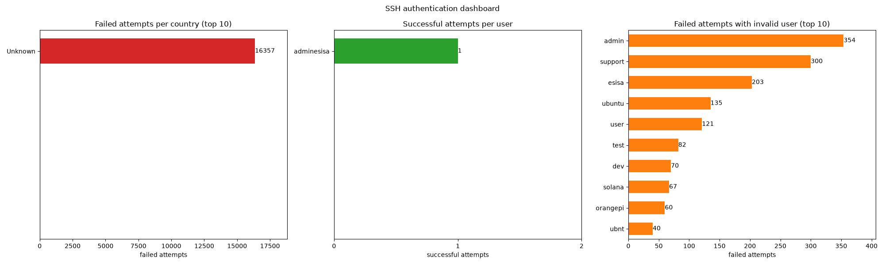

# Analyse des logs SSH

Projet réalisé en Python dans le cadre d'un cours. L'objectif est d'analyser des fichiers de logs SSH (`auth.log`) afin de repérer les tentatives de connexion, d'identifier leur origine géographique et de présenter certaines statistiques sous forme de graphiques.

## Fonctionnalités

Le programme traite 4 fichiers de logs datant de mai 2026 et génère un dashboard contenant 3 graphiques :

1. Les tentatives de connexion échouées par pays.

2. Les connexions réussies par utilisateur.

3. Les tentatives échouées avec un `invalid user`, regroupées par nom d'utilisateur.



## Structure du projet

```text

log_analysis/

├── main.py

├── ingestion/

│   └── raw.py

├── processing/

│   ├── extract_transforme.py

│   └── geo_location.py

├── serving/

│   ├── aggregate.py

│   └── dashboard.py

├── storage/

│   ├── country_cache.py

│   ├── countries.json

│   └── postgres_store.py

└── data/

```

- `main.py` : lance le traitement complet.

- `ingestion/raw.py` : lit les fichiers de logs, y compris les fichiers compressés `.gz`.

- `processing/extract_transforme.py` : extrait les informations des lignes de logs.

- `processing/geo_location.py` : récupère le pays associé à une adresse IP.

- `serving/aggregate.py` : prépare les tableaux de statistiques.

- `serving/dashboard.py` : génère les graphiques avec Matplotlib.

- `storage/country_cache.py` : conserve les pays déjà récupérés pour éviter les requêtes répétées.

- `storage/postgres_store.py` : contient la partie bonus pour le stockage dans PostgreSQL.

Le traitement suit cet ordre : lecture des fichiers, extraction des événements, calcul des statistiques, puis génération du dashboard. La géolocalisation intervient pendant le calcul des échecs par pays.

## Installation et lancement

**Prérequis :**

- Python 3.12

- uv

- Les dépendances indiquées dans `pyproject.toml` : `matplotlib`, `requests` et `psycopg2-binary`.

**Étapes :**

1. Installer les dépendances :

```bash

uv sync

```

2. Placer les 4 fichiers de logs dans le dossier `data/`.

3. Configurer le token ipinfo.io avec une variable d'environnement.

Sous PowerShell :

```powershell

$env:IPINFO_TOKEN = “mon_token"

```

4. Lancer le programme :

```bash

python main.py

```

Le premier lancement peut prendre quelques minutes, car il faut récupérer les informations géographiques d'environ 1 850 adresses IP. Les résultats sont ensuite enregistrés dans `storage/countries.json`, ce qui évite de refaire les mêmes requêtes lors des prochains lancements.

## Fonctionnement

### 1. Lecture des fichiers

Dans `raw.py`, la fonction `to_rows()` parcourt les fichiers présents dans `data/`.

Elle utilise le module `gzip` pour lire les fichiers compressés en `.gz`. Les erreurs de lecture sont enregistrées dans `raw.log`.

### 2. Extraction des tentatives de connexion

Dans `extract_transforme.py`, les lignes sont analysées pour récupérer les informations utiles.

Un exemple de ligne :

```text

May 24 00:09:01 server sshd[1351002]: <message>

```

Le traitement se fait en plusieurs étapes :

- Je garde uniquement les lignes contenant des messages de `sshd`. Les autres services comme CRON, sudo et systemd ne sont pas concernés.

- Une première regex récupère les différentes parties de la ligne. J'utilise `groupdict()` pour accéder aux groupes nommés.

- D'autres regex permettent ensuite de reconnaître les connexions réussies (`Accepted`), les échecs (`Failed password`) et les messages répétés (`message repeated N times`).

Les fichiers ne contiennent pas l'année, donc j'ai fixé `YEAR = 2026` dans le code.

Chaque événement extrait est représenté par un dictionnaire contenant notamment la date, l'adresse IP, le nom d'utilisateur et le résultat de la tentative. Le champ `count` permet aussi de gérer les messages répétés.

### 3. Géolocalisation et cache

Le module `geo_location.py` utilise l'API ipinfo.io pour obtenir le pays correspondant à une adresse IP.

Pour éviter de faire plusieurs fois la même requête, les résultats sont conservés dans `storage/countries.json`.

Lorsqu'une IP est déjà présente dans le cache, le pays est directement récupéré depuis le fichier. Si une requête échoue, le résultat n'est pas enregistré afin de pouvoir réessayer plus tard.

### 4. Calcul des statistiques et dashboard

Le fichier `aggregate.py` prépare les trois tableaux utilisés dans le dashboard :

- Échecs regroupés par pays.

- Connexions réussies regroupées par utilisateur.

- Échecs avec un utilisateur invalide, regroupés par nom.

Les résultats sont triés du plus grand au plus petit.

Le fichier `dashboard.py` utilise Matplotlib pour afficher les trois graphiques dans une seule figure. L'image générée est enregistrée sous `dashboard.png`.

## Quelques choix de traitement

Pendant le développement, j'ai rencontré plusieurs cas particuliers dans les fichiers de logs.

**Gestion des messages répétés**

Certaines lignes ressemblent à ceci :

```text

message repeated 4 times: [ Failed password ... ]

```

Cela signifie que le même événement s'est produit 4 fois. Il ne faut donc pas compter cette ligne comme une seule tentative.

J'ai ajouté un champ `count` pour prendre en compte ces répétitions dans les statistiques. Sans ce traitement, j'aurais obtenu 9 088 échecs au lieu de 16 357.

**Éviter les doublons**

Les messages `pam_unix ... authentication failure` correspondent aux mêmes échecs que les lignes `Failed password`. Je ne les compte donc pas pour éviter de compter deux fois une même tentative.

**Limiter les requêtes API**

Je regroupe d'abord les échecs par adresse IP, puis je récupère le pays une seule fois par IP différente. Cela représente 1 852 adresses IP dans les fichiers fournis.

**Protection du token**

Au début, le token ipinfo était directement écrit dans le code. Je l'ai remplacé par une variable d'environnement pour éviter de l'exposer dans le dépôt Git.

## Résultats obtenus

Voici les statistiques calculées à partir des fichiers fournis :

| Mesure | Résultat |

|---|---:|

| Lignes lues | 65 565 |

| Tentatives extraites | 10 963 |

| Tentatives échouées (répétitions comprises) | 16 357 |

| Adresses IP différentes avec des échecs | 1 852 |

| Échecs avec un `invalid user` | 3 249 |

| Connexions réussies | 1 |

La seule connexion réussie concerne l'utilisateur `adminesisa`.

L'utilisateur `root` est celui qui a reçu le plus de tentatives échouées, avec 13 090 échecs. Pour les utilisateurs invalides, les noms les plus essayés sont `admin`, `support` et `esisa`.

## Logs de l'application

Les différents modules disposent de leurs propres fichiers `.log` :

- `raw.log`

- `extract_transforme.log`

- `geo_location.log`

- `aggregate.log`

- `dashboard.log`

- `country_cache.log`

- `postgres_store.log`

Ils enregistrent les warnings et les erreurs avec le format suivant :

```text

date|niveau|module|message

```

On y retrouve notamment les lignes non reconnues, les dates invalides, les erreurs de requêtes API ou encore les graphiques sans données.

J'ai également ajouté une fonction `test_errors()` dans `extract_transforme.py` pour tester la gestion des erreurs avec des lignes volontairement incorrectes.

## Bonus : stockage PostgreSQL

J'ai ajouté un module `postgres_store.py` utilisant `psycopg2` pour enregistrer les événements dans une table `events`.

Cette partie permet également de calculer deux des tableaux du dashboard directement avec des requêtes SQL, en utilisant notamment `SUM()` et `GROUP BY`.

La connexion à PostgreSQL se configure avec les variables d'environnement suivantes :

- `PGHOST`

- `PGPORT`

- `PGDATABASE`

- `PGUSER`

- `PGPASSWORD`

Si PostgreSQL n'est pas disponible, l'erreur est enregistrée dans le fichier de log et le programme peut continuer en utilisant les tableaux calculés avec Python.

## Limites du projet

- L'API gratuite d'ipinfo.io possède une limite de requêtes mensuelles.

- Les adresses IP privées (par exemple `10.x.x.x`) ne correspondent pas à un pays et sont donc affichées comme `Unknown`.

- L'année doit être définie manuellement dans le code, car elle n'est pas présente dans les logs.

- Le traitement concerne les connexions SSH par mot de passe. Les connexions par clé SSH ne sont pas analysées.
